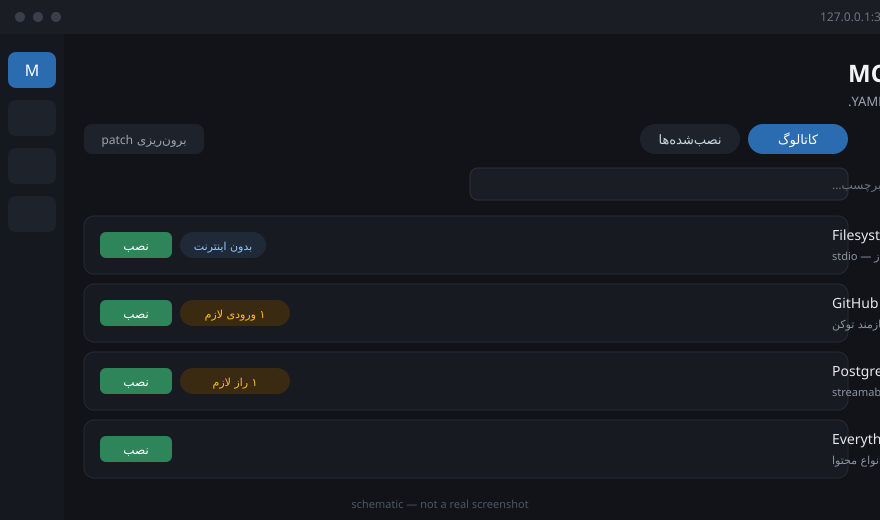

<div dir="rtl">

# استودیوی MCP برای DeepSeek Harness

[](https://github.com/mfallah/dsh-mcp-studio/actions/workflows/ci.yml)
[](LICENSE)

**سرورهای MCP را از داخل خودِ Harness ببین، نصب کن، وصل شو و مدیریت کن — بدون دست‌زدن به YAML.**

`@mfallah/dsh-mcp-studio` یک افزونهٔ DeepSeek Harness است که یک پنل فارسی و راست‌به‌چپ به رابط وب اضافه می‌کند.
به‌جای اینکه برای هر سرور یک بلوک `insert` در `cordis.patch.yml` بنویسی، از کاتالوگ انتخاب می‌کنی، فرم را پر می‌کنی،
اتصال را می‌آزمایی و نصب می‌کنی. تعریف سرورها در انبار خودِ افزونه ذخیره می‌شود، پس لایهٔ پروفایل تو دست‌نخورده می‌ماند.



> تصویر بالا یک نمای شماتیک است، نه عکس واقعی از صفحه. برای جای‌گذاری عکس واقعی، فایل خود را در
> `docs/assets/` بگذار و همین خط تصویر را به آن اشاره بده.

## نصب سریع (۶۰ ثانیه)

پیش‌نیاز: Node.js 22 یا بالاتر و یک پروفایل Harness که `dsh` آن را می‌شناسد.

```powershell
cd F:\harness\dsh-mcp-studio

# ۱) پیش‌نمایش: فقط می‌گوید چه کاری انجام می‌شود، هیچ فایلی را تغییر نمی‌دهد
powershell -ExecutionPolicy Bypass -File .\install.ps1 -DryRun

# ۲) نصب
powershell -ExecutionPolicy Bypass -File .\install.ps1

# ۳) Harness را دوباره اجرا کن
dsh web
```

بعد <http://127.0.0.1:3080> را باز کن و روی آیکن **استودیوی MCP** در نوار کناری کلیک کن.

اگر Git-Bash، WSL یا macOS/Linux داری، معادلش این است:

```bash
bash install.sh --dry-run   # پیش‌نمایش
bash install.sh             # نصب
```

> نصب دستی معادل، اگر نصب‌کننده را نمی‌خواهی:
> ```powershell
> dsh plugin --profile web add F:\harness\dsh-mcp-studio
> # یا مستقیم از مخزن، بدون هیچ گام ساختی:
> dsh plugin --profile web add github:mfallah/dsh-mcp-studio
> ```
> همین یک فرمان کافی است؛ بسته لایهٔ خودش را از `package.json` → `dsh.bundle.patch` می‌آورد.
> خروجی ساخته‌شده (`lib/`) در مخزن کامیت شده است، چون DSH بستهٔ `lib/client.js` را در زمان بالا آمدن
> می‌خواند؛ پس نصب از GitHub به `pnpm run build` نیاز ندارد. بسته هیچ وابستگی زمان‌اجرایی هم ندارد.

راهنمای کامل هر سه سیستم‌عامل، نصب بدون اینترنت و حذف کامل: [docs/INSTALL.md](docs/INSTALL.md).

## امکانات

| امکان | چه کاری می‌کند |
| --- | --- |
| کاتالوگ | ۳۴ سرور آمادهٔ همراهِ افزونه که بدون اینترنت کار می‌کنند، به‌علاوهٔ جست‌وجو در رجیستری رسمی MCP |
| نصب با فرم | ورودی‌های هر سرور به‌صورت فرم نمایش داده می‌شوند؛ ورودی‌های حساس به‌جای فایل، در انبار راز ذخیره می‌شوند |
| آزمون اتصال | پیش از ذخیره، یک نمونهٔ واقعی وصل می‌شود و ابزارهای کشف‌شده، نسخهٔ پروتکل و زمان صرف‌شده را نشان می‌دهد |
| دو گونهٔ انتقال | `stdio` (فرایند محلی: `npx`، `uvx`، `docker`، …) و `streamable-http` |
| مدیریت زنده | روشن/خاموش کردن، راه‌اندازی مجدد، ویرایش و حذف هر سرور، بدون ریاستارت کردن Harness |
| ابزارها و لاگ | فهرست ابزارهای هر سرور با فضای نام `mcp__<نام>__<ابزار>` و لاگ زندهٔ آن سرور |
| تشخیص محیط اجرا | یک‌بار بررسی می‌کند `node`، `npx`، `npm`، `pnpm`، `bunx`، `uvx`، `python` و `docker` روی سیستم هستند یا نه |
| مدیریت رازها | مقادیر با `${secret:NAME}` در پیکربندی ارجاع داده می‌شوند و هرگز به مرورگر فرستاده نمی‌شوند |
| برون‌ریزی patch | کل وضعیت را به‌صورت یک بلوک `cordis.patch.yml` می‌دهد، برای وقتی که بخواهی افزونه را کنار بگذاری |
| فارسی و RTL | افزونه خودش بستهٔ زبان «فارسی» را ثبت می‌کند؛ پنل دوزبانه است و جهت متن را از زبان فعال Harness می‌گیرد |

## امنیت: چه چیزی روی رایانهٔ تو اجرا می‌شود

- **خودِ افزونه** درون همان فرایند Harness اجرا می‌شود؛ سرویس جداگانه یا پورتی باز نمی‌کند.
- **هر سرور فعال** یک فرایند فرزند است که افزونهٔ رسمی `@deepseek-ai/dsh-mcp-client` آن را راه می‌اندازد.
  محیط فرایند از محیط پاک‌سازی‌شدهٔ Harness به‌علاوهٔ متغیرهایی که خودت تعیین کرده‌ای ساخته می‌شود.
  یعنی هر سروری که نصب می‌کنی، همان دسترسی‌های فرایند Harness را دارد.
- **رازها** در `$DSH_HOME/mcp-studio/secrets.json` ذخیره می‌شوند، با مجوز `0600` و روی ویندوز با ACL
  محدود به کاربر جاری. مقدار راز هیچ‌وقت در `servers.json`، در لاگ، در رویدادها یا در پاسخ‌های HTTP نمی‌آید؛
  فقط *نام* راز رد و بدل می‌شود.
- **فایل سرورها** `$DSH_HOME/mcp-studio/servers.json` است و می‌تواند `${env:NAME}` و `${secret:NAME}` داشته باشد.
- **رابط محلی** روی مسیر `/mcp-studio-api` سوار می‌شود؛ فقط از loopback پذیرفته می‌شود، هدر اجباری
  `x-mcp-studio: 1` دارد و درخواست‌های cross-origin را رد می‌کند.
- **حذف کامل**: `install.ps1 -Uninstall` افزونه را از پروفایل برمی‌دارد. برای پاک کردن داده‌ها هم
  پوشهٔ `$DSH_HOME/mcp-studio` را حذف کن (این پوشه سرورها، رازها و نسخه‌های پشتیبان را نگه می‌دارد).

## چطور کار می‌کند

```
┌─────────────────── DeepSeek Harness (یک فرایند) ────────────────────────────────┐
│                                                                                 │
│  مرورگر  http://127.0.0.1:3080                    میزبان (Node.js)              │
│  ┌─────────────────────────────┐                 ┌───────────────────────────┐  │
│  │  پنل استودیوی MCP           │  POST           │  @mfallah/dsh-mcp-studio  │  │
│  │  ├ کاتالوگ                  │  /mcp-studio-   │  ├ سرویس (RPC)            │  │
│  │  ├ نصب‌شده‌ها               │  api/rpc        │  ├ servers.json           │  │
│  │  ├ فرم افزودن/ویرایش        │ ──────────────▶ │  └ secrets.json           │  │
│  │  └ ابزارها + لاگ            │ ◀────────────── │            │ mount        │  │
│  └─────────────────────────────┘   JSON          │  ┌─────────▼─────────────┐  │
│                                                   │  │ dsh-mcp-client × N   │  │
│                                                   │  └─────────┬───────────┘  │
│                                                   └────────────┼──────────────┘
└────────────────────────────────────────────────────────────────┼───────────────┘
                                                                 │ stdio / HTTP
                                                                 ▼
                                                    سرورهای MCP (npx، uvx، docker، …)
```

نکتهٔ مهم معماری: افزونه هیچ‌وقت `cordis.patch.yml` را نمی‌نویسد. تعریف سرورها در انبار خودش می‌ماند و
سرویس میزبان برای هر سرور فعال، یک نمونهٔ `dsh-mcp-client` را سوار می‌کند؛ همین باعث می‌شود افزودن و
حذف سرور بدون ریاستارت انجام شود.

## مستندات

- [نصب و حذف](docs/INSTALL.md) — ویندوز، macOS، Linux، نصب بدون اینترنت، حذف کامل
- [راهنمای استفاده](docs/USAGE.md) — گشت‌وگذار در پنل، افزودن سرور، رازها، لاگ‌ها
- [رفع اشکال](docs/TROUBLESHOOTING.md) — خطاهای رایج و محدودیت‌های شناخته‌شده
- [تغییرات](CHANGELOG.md)

## مجوز

MIT — [LICENSE](LICENSE)

</div>

---

## English (short)

**MCP Studio** is a DeepSeek Harness plugin that adds a visual, Persian-first (RTL) panel to the harness
web GUI: browse a catalog of MCP servers, install and connect them through a form, test the connection
before saving, and watch each server's tools and logs. Server definitions live in the plugin's own store
(`$DSH_HOME/mcp-studio/`), so your profile's `cordis.patch.yml` stays yours and no restart is needed to
add or remove a server.

**Install (Windows / PowerShell):**

```powershell
cd F:\harness\dsh-mcp-studio
powershell -ExecutionPolicy Bypass -File .\install.ps1 -DryRun   # preview, changes nothing
powershell -ExecutionPolicy Bypass -File .\install.ps1           # install
dsh web                                                          # restart, then open http://127.0.0.1:3080
```

**Install (Git-Bash / WSL / macOS / Linux):** `bash install.sh --dry-run`, then `bash install.sh`.

**Manual install:** `dsh plugin --profile web add <path-or-package>` — the package declares
`dsh.bundle.patch`, so the plugin activates itself. The built output (`lib/`) is committed, so a git-URL
install (`dsh plugin --profile web add github:mfallah/dsh-mcp-studio`) needs no build step; run
`pnpm run build` only after changing `src/`. The package has no runtime npm dependencies — its three
peers come from the harness.

**Security:** secrets are stored in `$DSH_HOME/mcp-studio/secrets.json` (mode `0600`; ACL tightened on
Windows) and never cross the browser boundary — only secret *names* do. The panel talks to the host over
a loopback-only `/mcp-studio-api` route that requires the `x-mcp-studio: 1` header and rejects
cross-origin requests. Each enabled server runs as a child process with the harness's scrubbed
environment plus the variables you set, so install only servers you trust.

**Remove everything:** `install.ps1 -Uninstall`, then delete `$DSH_HOME/mcp-studio`.

Full documentation is Persian-first; see [docs/INSTALL.md](docs/INSTALL.md),
[docs/USAGE.md](docs/USAGE.md) and [docs/TROUBLESHOOTING.md](docs/TROUBLESHOOTING.md).
